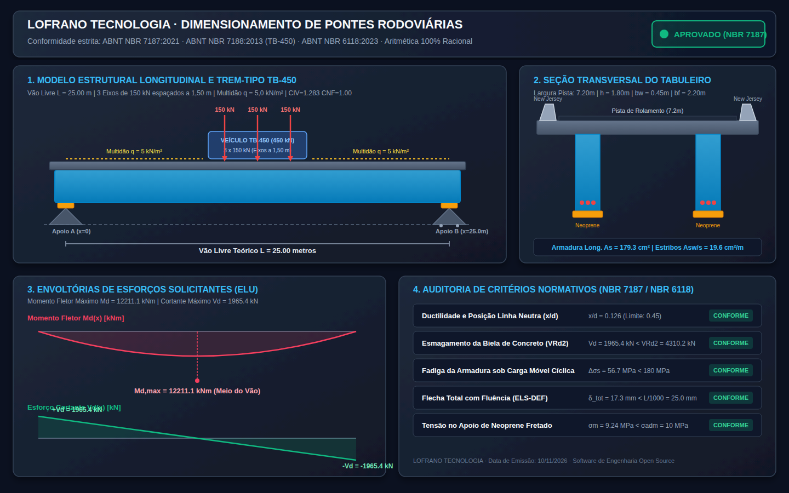

# Dimensionamento de Pontes de Concreto Rodoviárias · ABNT NBR 7187:2021 / NBR 7188:2013

[](https://github.com/martinlofranodeoliveira/dimensionamento-pontes-concreto-nbr7187/actions/workflows/ci.yml)
[](LICENSE)
[](https://www.python.org/)
[-success.svg)](https://docs.python.org/3/library/)
[](https://docs.python.org/3/library/fractions.html)

Motor analítico, determinístico e biblioteca computacional de alta fidelidade para **dimensionamento, análise estrutural e verificação de pontes e viadutos rodoviários em concreto armado e protendido**, em total conformidade com as normas técnicas brasileiras:
- **ABNT NBR 7187:2021** (*Projeto de pontes, viadutos e passarelas de concreto armado e de concreto protendido - Procedimento*);
- **ABNT NBR 7188:2013** (*Carga móvel rodoviária e de pedestres em pontes, viadutos, passarelas e outras estruturas*);
- **ABNT NBR 6118:2023** (*Projeto de estruturas de concreto - Procedimento*);
- **ABNT NBR 19783** (*Aparelhos de apoio de elastômero fretado*).

Desenvolvido segundo as diretrizes de engenharia de software da **LOFRANO TECNOLOGIA**, com **zero dependências externas de terceiros** (stdlib pura do Python 3.11+) e **banimento total de tipos de ponto flutuante (`float`)**, operando integralmente através da aritmética de frações racionais exatas (`fractions.Fraction`) e grandezas inteiras para eliminação absoluta de erros de arredondamento.

---

## Painel Técnico e Diagramas Estruturais (1440x900)

O sistema inclui um gerador vetorial de alta definição que projeta a ponte rodoviária completa: seção transversal do tabuleiro, diagrama estático com trem-tipo TB-450, envoltória de momentos fletores e esforços cortantes, distribuição transversal de cargas, detalhes das armaduras e dimensionamento dos aparelhos de apoio em neoprene fretado.



---

## Fundamentos Normativos e Formulação Analítica

### 1. Ações Móveis e Trem-Tipo Rodoviário TB-450 (ABNT NBR 7188:2013)
O modelo de carregamento móvel rodoviário padrão é composto pelo veículo de projeto **TB-450** com peso total de 450 kN (45 tf), constituído por 3 eixos de 150 kN cada, espaçados em 1,50 m:
- Carga por roda: $P_{\text{roda}} = 75\text{ kN}$ distribuída em área de contato retangular de $0{,}20\text{ m} \times 0{,}50\text{ m}$;
- Cargas distribuídas de multidão nos vãos de tráfego (fora do veículo): $q = 5\text{ kN/m}^2$;
- Cargas distribuídas em passeios de pedestres: $q_{\text{pass}} = 3\text{ kN/m}^2$.

### 2. Coeficientes de Majoração Dinâmica (ABNT NBR 7187:2021)
As cargas estáticas móveis são multiplicadas pelo Coeficiente de Majoração Dinâmica ($CMD$):
$$CMD = CIV \times CNF \times CIA$$

Onde:
1. **Coeficiente de Impacto Vertical ($CIV$)**:
   Para pontes e viadutos rodoviários em concreto:
   $$CIV = \begin{cases} 1{,}35, & \text{se } L \le 10\text{ m} \\ 1 + 1{,}06 \times \dfrac{20}{L + 50}, & \text{se } 10\text{ m} < L < 200\text{ m} \end{cases}$$
2. **Coeficiente de Número de Faixas ($CNF$)**:
   Reflete a probabilidade de concomitância de múltiplos veículos pesados em pistas com $n \ge 2$ faixas de tráfego:
   $$CNF = 1 - 0{,}05(n - 2) \ge 0{,}90$$
3. **Coeficiente de Impacto Adicional ($CIA$)**:
   Avalia as descontinuidades e transições estruturais, adotando-se normativamente $CIA = 1{,}15$ para vãos correntes com transição normal ou $CIA = 1{,}25$ em extremidades e juntas de dilatação.

### 3. Linhas de Influência e Esforços Solicitantes Máximos
Através das Linhas de Influência lineares e do Teorema de Barré:
- **Momento Fletor Crítico no Meio do Vão ($x = L/2$)**:
  - Ordenada máxima central: $\eta_2 = \frac{L}{4}$
  - Ordenadas dos eixos adjacentes (a $1{,}50\text{ m}$ de distância): $\eta_1 = \eta_3 = \frac{L}{4} - \frac{1{,}50}{2} = \frac{L}{4} - 0{,}75$
  - Momento característico do veículo:
    $$M_{Q,\text{veic}} = 150 \left(\eta_1 + \eta_2 + \eta_3\right) = 150 \left(3\frac{L}{4} - 1{,}50\right) = 112{,}5 L - 225\text{ kNm}$$
  - Momento da carga de multidão: $M_{q} = q \times \frac{L^2}{8}$
- **Esforço Cortante Crítico no Apoio ($x = 0$)**:
  - Eixo 1 no apoio ($\eta_1 = 1$), Eixo 2 a 1,50 m ($\eta_2 = \frac{L - 1{,}50}{L}$), Eixo 3 a 3,00 m ($\eta_3 = \frac{L - 3{,}00}{L}$)
  - Cortante característico do veículo:
    $$V_{Q,\text{veic}} = 150 \left(1 + \frac{L - 1{,}50}{L} + \frac{L - 3{,}00}{L}\right) = 150 \left(3 - \frac{4{,}50}{L}\right)$$
  - Cortante da carga de multidão: $V_{q} = q \times \frac{L}{2}$

### 4. Dimensionamento e Verificações Estruturais no ELU e ELS (NBR 6118 / NBR 7187)
- **Flexão Normal Simples**: Determinação da profundidade da linha neutra $x$, verificação dos limites de ductilidade ($x/d \le 0{,}45$ para aços CA-50 e concretos até C50), e cálculo da armadura longitudinal de tração $A_s = \frac{M_d}{f_{yd}(d - 0{,}4x)}$.
- **Esforço Cortante e Esmagamento de Bielas**: Verificação da biela de compressão $V_{Rd2} = 0{,}27 \alpha_v f_{cd} b_w d$, e determinação da taxa de armadura transversal de estribos $A_{sw}/s$ (Modelo I da NBR 6118).
- **Verificação de Fadiga das Armaduras**: Avaliação da oscilação de tensões na armadura tracionada sob a parcela frequente de carga móvel:
  $$\Delta \sigma_s = \frac{M_{q,\text{fad}}}{0{,}9 d A_s} \le \Delta f_{sd,fad} \quad (\approx 80\text{ a }100\text{ MPa})$$
- **Verificação do Estado Limite de Deformação (ELS-DEF)**: Flecha elástica imediata + flecha diferida no tempo por fluência ($\alpha_f = 2{,}5$) sob combinação frequente: $\delta_{\text{total}} \le L/1000$.
- **Dimensionamento dos Aparelhos de Apoio de Neoprene Fretado**: Reação máxima vertical $R_{\max} = V_g + V_q$, cálculo da área de contato $A_{\text{apoio}} = a \times b$ tal que a tensão média satisfaça $\sigma_m = \frac{R_{\max}}{A_{\text{apoio}}} \le \sigma_{\text{adm}} \quad (10\text{ MPa})$.

---

## Instalação e Execução

### Requisitos do Sistema
- Python 3.11 ou superior (testado oficialmente no Linux e Windows até Python 3.14).
- Nenhuma biblioteca externa é necessária.

### Instalação em Modo Editável
```bash
git clone https://github.com/martinlofranodeoliveira/dimensionamento-pontes-concreto-nbr7187.git
cd dimensionamento-pontes-concreto-nbr7187
pip install -e .
```

---

## Uso via Linha de Comando (CLI)

O utilitário disponibiliza interface CLI amigável e saída estruturada:

```bash
# Executar dimensionamento com os parâmetros padrão (Ponte de 25 metros de vão, TB-450)
dimensionamento-pontes --calcular

# Gerar todos os relatórios (Memorial, CSV sanitizado, JSON RFC 8259, SVG e Pacote ZIP)
dimensionamento-pontes --calcular --exportar-todos --saida-dir ./relatorios

# Personalizar vão da ponte, número de faixas e classe de concreto
dimensionamento-pontes --calcular --vao 30 --largura-pista 7.2 --faixas 2 --fck 40
```

---

## Verificação e Auditoria Independente em SQLite

O repositório inclui uma ferramenta formal de auditoria independente (`tools/verify_independent.py`) que recalcula todas as grandezas em um banco de dados em memória **sem importar nenhum módulo do código-fonte**, garantindo validação cruzada externa de todas as fórmulas normativas.

```bash
# Executar auditoria formal independente
python3 tools/verify_independent.py

# Executar a suíte de testes unitários locais
python3 -m unittest discover -s tests -v
```

---

## Licença

Distribuído sob a licença **MIT**. Consulte o arquivo [LICENSE](LICENSE) para maiores detalhes.

**LOFRANO TECNOLOGIA** · Engenharia de Alta Confiabilidade e Precisão Racional.
